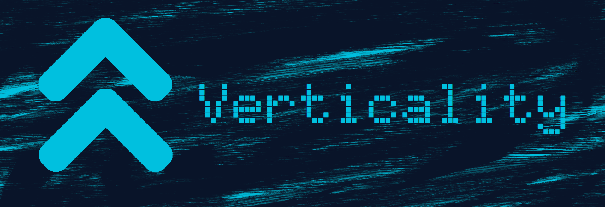

# A libre video game about grappling hook based parkour.
 ```Verticality``` is a 3D game, running in ```Godot Engine 4.7.2```. It was created as a vessel to learn how to use the Godot Engine.

It is licensed under the ```GNU General Public license 3.0```.   

# Gameplay
Verticality is a game about grappling to the top of the level by left clicking on floating blocks in    
the given level. The goal is to make it to the highest block, and make it all the way back down to   
the flat plane that you started on. Try to complete levels as fast as you can, beating your high scores.
