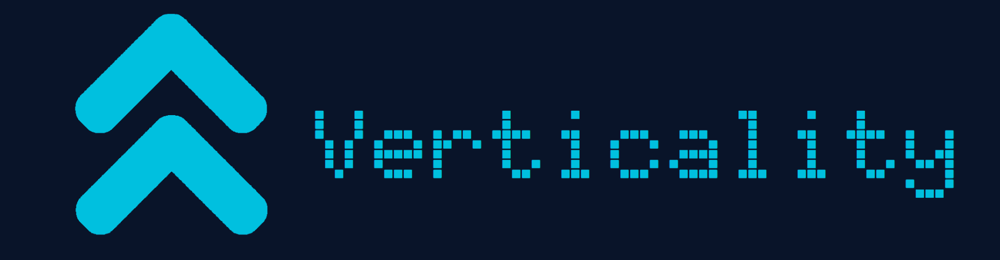

# A libre video game about grappling hook based parkour.
 ```Verticality``` is a 3D game, running in ```Godot Engine 4.7.2```. It was created as a vessel to learn how to use the Godot Engine.

It is licensed under the ```GNU General Public license 3.0```.   

# Gameplay
This is a game about grappling to the top of the level by left clicking on floating blocks in    
the given level. The goal is to make it to the highest block, and make it all the way back down to   
the flat plane that you started on. Try to complete levels as fast as you can, beating your high scores.

# Bulding from source

## Prerequisites 
### Before building, ensure you have the following software:
```Godot Engine 4.7.2```

```Git (Latest Release)```

```Godot Export Templates (Installed within Godot)```

## Step 1
Open terminal and clone the github repository with the commmand:

    https://github.com/Reco200/Verticality.git

## Step 2
Import the project in Godot by clicking "Import" and then selecting the folder that Git cloned.

## Step 3
Open the project and open the Godot project export gui by clicking 

```Project -> Export```

## Step 4
Add the desired platforms by clicking the ```Add...``` button at the top of the Export window.
Click the platform that you would like to compile for.

## Step 5 
It will say ```"- No export template found at the expected path"```

Click the ```Manage Export Templates``` button in grey at the bottom.
Check the boxes of the corresponding platforms you want to build for
and then click the ```Install Selected Templates``` button at the top.

## Step 6
Once the Export Templates install, re-open the Export GUI and configure the game export options however you want.
Once you configure your export; you can now click export project, and it will output to where ever you told it to. 
#### Congratulations! The game is now built for your prefered platform.

